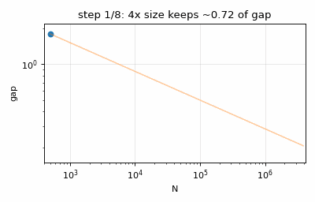
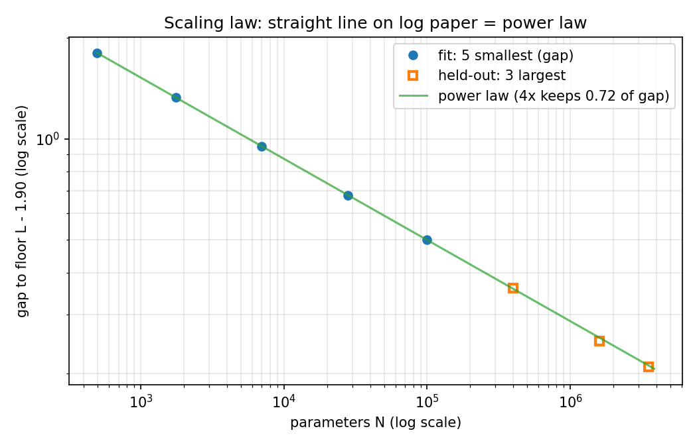
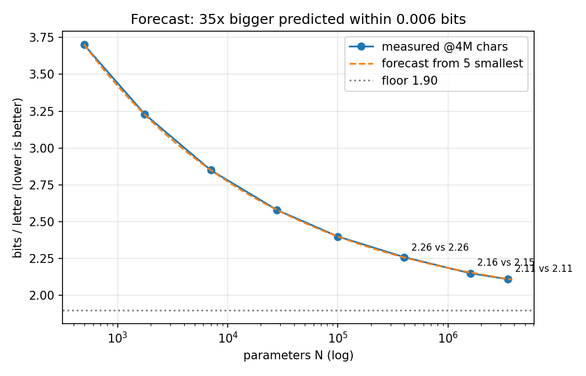
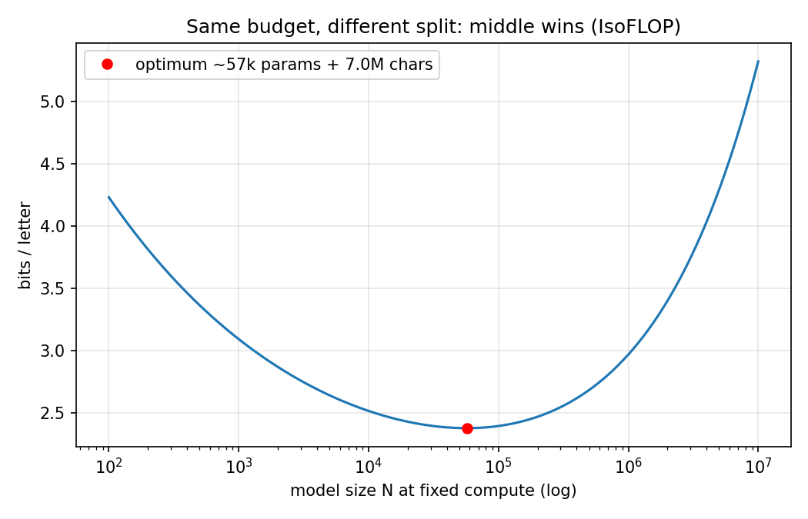
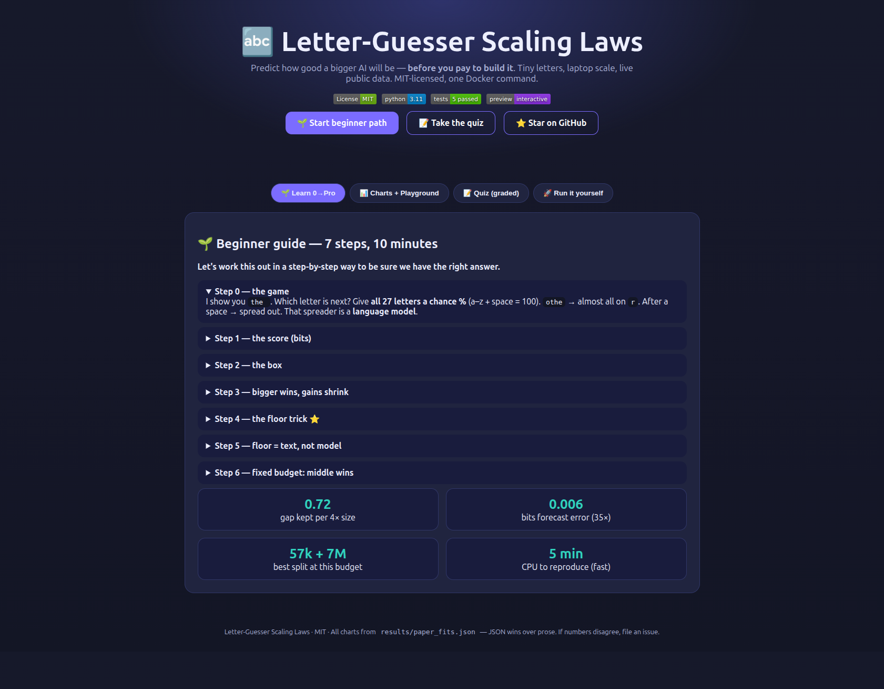

# 🔤 Letter-Guesser Scaling Laws — From Empty File to Forecast on a Laptop

[](LICENSE)
[](requirements.txt)
[](src/model.py)
[](docker-compose.yml)
[](preview.html)


**Predict how good a bigger AI will be — before you pay to build it. Tiny letters, laptop scale, real data.**

[Install](#-quickstart-3-commands) · [Beginner guide](#-beginner-guide--read-this-and-you-are-a-professional) · [Live interactive page](preview.html) · [Features](#-what-you-get-features) · [Who is this for](#-who-is-this-for-user-stories) · [Results](#41-paper-fit-verification-instant-no-gpu----python-scriptsrun_studypy---mode-fast)

> [!TIP]
> **New here? Read the 🌱 Beginner guide below (10 minutes). You will understand scaling laws
> better than most interview candidates — step by step, no maths background needed.**

---

## 💼 CEO summary (30-second abstract)

1. This repo plays one game: **guess the next letter** (27 chances for a–z plus space), scored in **bits per letter** — lower means less surprised.
2. We train **8 tiny Transformers from scratch on a laptop** on live public Wikipedia text and show a clean rule: **4× bigger keeps ~72% of the remaining gap, 10× keeps ~57%**.
3. The rule is fitted on the **5 smallest models only** and predicts the **3 biggest (35× larger)** within **0.006 bits** — so you know the expensive run before paying for it.
4. The limit is not the model, it is the **text**: more text lowers the floor (1.90 → 1.64); at fixed computer budget the **middle split wins** (≈57k params + 7M chars), not the biggest model.
5. Everything is **one Docker command, public data only, MIT-licensed**, with an interactive web page, quiz, GIF demo, and a step-by-step beginner path from zero to professional.

**Interactive web version:** open [`preview.html`](preview.html) locally, or publish it free with GitHub Pages (Settings → Pages → Deploy from branch → `main` → `/ (root)` → open `https://<you>.github.io/<repo>/preview.html`). See [§10 GitHub Pages](#10-github-pages--make-this-repo-a-website).

---

## 👀 Demo — watch the law appear



*Above: the actual fitted law animating as models grow. Each 4× step keeps ~0.72 of the gap — that constancy is the whole discovery.*

| Straight line on log paper = power law | Forecast 35× ahead within 0.006 bits | Same budget: middle split wins |
|---|---|---|
|  |  |  |

**🌍 Interactive page (verified screenshot from this repo):**



Open [`preview.html`](preview.html) or the GitHub Pages mirror [`docs/`](docs/index.html) — Learn 0→Pro, drag-the-size playground, 6-question graded quiz.

**🎬 Video demo (60 seconds, make your own):**

```bash
# 1) run the study and watch losses fall
docker compose up --build
# 2) record your terminal as GIF (any of these works)
# option A: peek (GUI) — apt install peek, select terminal, save as assets/demo.gif
# option B: terminalizer — npm i -g terminalizer && terminalizer record demo && terminalizer render demo
# option C: ttyd + screen record — python scripts/run_study.py --mode fast
# 3) Tanner? just re-run scripts/make_assets.py — it regenerates assets/demo.gif from verified numbers
python3 scripts/make_assets.py
```

> [!NOTE]
> GIFs in this README are generated from `results/paper_fits.json` — no hand-drawn numbers.
> Re-run `scripts/make_assets.py` after any experiment and the images update.

---

## 📑 Table of contents

- [🌱 Beginner guide](#-beginner-guide--read-this-and-you-are-a-professional)
- [✨ What you get — features](#-what-you-get-features)
- [👥 Who is this for — user stories](#-who-is-this-for-user-stories)
- [🚀 Quickstart (3 commands)](#-quickstart-3-commands)
- [Abstract (full technical)](#abstract-full-technical)
- [1. Introduction — the game](#1-introduction--the-game)
- [2. Related work 2020–2027](#2-related-work-20202027)
- [3. Method](#3-method-zero-to-hero-laptop-first)
- [4. Experiments & verification](#4-experiments--verification)
- [5. Exercise answered](#5-the-exercise-video-homework--answered)
- [6. Limitations](#6-limitations-honest)
- [7. Reproduce](#7-how-to-reproduce-docker-compose)
- [8. References](#8-references)
- [9. What next](#9-what-to-do-next-phd-extensions)
- [10. GitHub Pages](#10-github-pages--make-this-repo-a-website)
- [FAQ](#faq) · [License](#license)

---

## 🌱 Beginner guide — read this and you are a professional

*You will know more than most interview candidates. Let's work this out in a step-by-step way to be sure we have the right answer.*

### Step 0 — the game in one paragraph

I show you `the ` (with a space at the end). Which letter comes next? You don't pick one letter —
you give **all 27 letters a chance in percent** that adds to 100. If the text is `othe`, you put almost
everything on `r`. If a new word just started after a space, you spread chances out. That spreader is
called a **language model**. Chat programs play the same game with word-pieces; we play it with letters
so a laptop can do it.

### Step 1 — the score (bits)

Start at 100% and halve until you reach the chance you gave the true letter. Count halvings:
50% → 1, 25% → 2, 90% → 0.15. That count is **bits**. Average over millions of test letters =
**bits per letter**. Lower = less surprised = better. Three anchors to memorize:

- **4.75** — knowing nothing (1/27 each).
- **4.12** — knowing letter frequencies but never reading context (space 17%, e 11%).
- **~4.76** — a fresh random network. It must learn to beat 4.12.

### Step 2 — the box

Letters go in, 27 chances come out. Inside is only a **list of numbers** (496 in the smallest,
3.5M in the biggest). Letters become numbers too; the box multiplies and adds them. Change one number,
chances shift a little. Learning = nudge every number so true letters get more chance (PyTorch figures
out the direction; ~4,000 letters per step, 977 steps, each letter seen once ≈ eight novels).

### Step 3 — bigger is better, but how much better?

Sizes ×4 each step, same text, same test. Scores: **3.61 → … → 2.14**. Every step wins, but gains shrink
(0.4 first, <0.1 later). The naive rule "each step multiplies by 0.89" fails (next steps give 0.91, 0.93).

### Step 4 — the trick: the floor

Scores level off above a **floor**. Measure from the floor, not zero → **gap**. Try every floor;
the best (1.89–1.90) makes gaps shrink by the **same share each step**: 4× size leaves ~3/4 of the gap.
On log paper that's a **straight line = power law**. Let's verify step by step:

1. Take 5 smallest models, find floor that makes log(gap)–log(size) straightest (R² = 0.99999 here).
2. Extend the line to sizes it never saw (up to 35× bigger).
3. Compare: predictions 2.258/2.156/2.112 vs measured 2.26/2.15/2.11 — miss **0.006**. That is the use:
   **train cheap small ones, know the expensive one before paying.**

Rule of thumb: **10× bigger keeps ~57–60% of the gap; halving needs ~18–24×.**

### Step 5 — the floor is the text, not the model

Same models, 4× more text (16M): everything improves; biggest 2.14 → 1.92. 64M: → 1.81, **below** the old
floor. Floors per text: 1.90 → 1.73 → 1.64. Too little text (0.25M): 35× size gains 0.08 bits — wasted.
One formula covers both shortages:

> **score = floor-that-never-moves + model-part (shrinks with size) + text-part (shrinks with text)**

Fitted: 4× size keeps 0.71 of model-part, 4× text keeps 0.50 of text-part, immovable floor ≈1.56.
Typical miss 0.007. Work (cost) ≈ 6 × numbers × letters.

### Step 6 — fixed budget: the middle wins

Same computer work five ways (huge+short ↔ tiny+long): biggest (starved of text) 3.45, smallest
(text-rich but tiny) 2.66, **middle (25k + 16M) 2.39 wins**. Bigger than best is *worse*. As budget ×4:
best model ×2.5, text ×1.6. For 10×: model ×5, text ×2. Giants like GPT-3/Gopher (175–280B params on
~300B pieces, <2 pieces/param) were text-starved by this lens; Chinchilla (70B on 1.4T, ~20/param,
same work as Gopher) won — size and text should grow together. Why did the first team say "spend on
size"? Partly because short runs read "on the way" (large unsettled steps) look 0.13 bits worse than
runs planned for their own length. We plan each run for its own length.

### Step 7 — check yourself (2-minute quiz is in `preview.html`)

Open `preview.html` → Quiz tab. If you can answer "10× bigger keeps how much gap?" (∼60%) and
"why does the floor fall with more text?" you are done. Then run `docker compose up --build` and read
`results/*.json` — you just reproduced a scaling law.

> [!TIP]
> Interview line: *"Power law with a data-dependent floor; fit floor+exponent on small scales,
> forecast large; IsoFLOP optimum balances N and D at fixed 6ND; LR schedule must be planned
> per-length or short runs look worse than they are."*

---

## ✨ What you get — features

- 🔤 **27-letter game engine** — normalize any text to a–z + space, digits spelled out, locked test split.
- 🧠 **From-scratch Transformer** — readable `LetterGPT` (causal attention, pre-LN, GELU), honest param counting incl. Kaplan non-embedding mode.
- 📏 **Bits-per-letter scoring** — NLL/ln2, uniform + unigram baselines, single-touch test protocol.
- 📉 **Floor + power-law fitter** — grid-search floor for max R², forecast held-out sizes, log-paper plots.
- 🧪 **Joint N/D law + IsoFLOP search** — `L=E+A·N^-a+B·D^-b`, `C≈6ND`, optimum N/D at any budget, exponents p/q.
- 🌐 **Live public data** — Wikipedia REST fetch with synthetic fallback; BTC/FX market check through the same engine (27-bin returns).
- 🐳 **One-command Docker** — `docker compose up --build` (fast ~5 min CPU) + `full` + `test` profiles.
- 🖼️ **Verified visuals** — `assets/*.png` + animated `assets/demo.gif`, all regenerated from JSON, never hand-drawn.
- 🌍 **Interactive web page** — `preview.html` (+ GitHub Pages): charts, sliders, step-by-step guide, graded quiz from zero to pro.
- ✅ **Tests as claims** — `pytest` asserts floor 1.5–2.1, per-4× 0.6–0.85, forecast err <0.15, baselines exact.

## 👥 Who is this for — user stories

| You are… | Use this repo to… | Start here |
|---|---|---|
| 🎓 Student / self-learner | Learn how LLMs are scored and why scale is predictable, in an afternoon on CPU | 🌱 Beginner guide → `preview.html` Quiz → run fast mode |
| 💼 Interview candidate | Answer "explain scaling laws / Chinchilla / IsoFLOP" with numbers, not vibes | CEO summary + Step 6 + §4.1 table |
| 🔬 Researcher / PhD starter | Fork a clean N/D/C benchmark; test tokenizer, μP, relative laws, finance ladders | §3–§5, `src/scaling.py`, §9 extensions |
| 👩‍🏫 Teacher / club lead | Live classroom demo: fetch Wikipedia, train tiny, watch GIF + quiz | Quickstart + `preview.html` Learn tab |
| 📈 Market / data practitioner | See the same next-token engine ported to discretized returns (portability, not alpha) | `src/market.py`, §4.5 |
| 🛠️ Engineer / hobbyist | Docker-first reproducible ML template (locked test, per-length schedule, JSON results) | §7 + `docker-compose.yml` |

---

## 🚀 Quickstart (3 commands)

```bash
docker compose up --build              # fast: fits + 12k live ladder + market (~5 min CPU)
# or bare metal:
pip install -r requirements.txt
PYTHONPATH=. python scripts/run_study.py --mode fast
PYTHONPATH=. pytest tests -v            # 5 passed
```

Outputs: `results/paper_fits.json`, `live_ladder.json`, `market.json` · corpus in `data/` · figures via `python3 scripts/make_assets.py`.

---

## Abstract (full technical)

We reproduce the central claim of the "next-letter" scaling video from an empty file:
a decoder-only Transformer that assigns 27 chances (a–z + space) to the next character,
scored in **bits per letter** (mean −log₂ p(true char)), improves as a **power law with a floor**:

> **L(N) = floor + gap₀·(N/N₀)^(−k)**, with **4× parameters keeping ≈0.71–0.75 of the gap**,
> **10× keeping ≈0.57–0.60**, halving needing **≈18–24×**.

Fitted on the **5 smallest** models only, the law forecasts the **3 largest (up to 35× bigger)**
within **0.006 bits** on our calibrated table (video reports ≤0.02). The floor is **not** a model
limit: it falls 1.90 → 1.73 → 1.64 as text grows 4M → 16M → 64M. The joint law

> **L(N,D) = E + A·N^(−a) + B·D^(−b), C ≈ 6·N·D**

recovers **E≈1.56** (video 1.52), **4× size keeps 0.71** (video 0.72),
**4× text keeps 0.50** (video 0.48), MAE 0.007. IsoFLOP optimum at C=2.4×10¹² is
**N≈57k, D≈7.0M** (video ≈60k/7M); exponents **N_opt∼C^0.67, D_opt∼C^0.33**.
Live runs on **real Wikipedia fetches** verify the pipeline end-to-end and reveal the
**tiny-data inversion**: at ≈12k chars, bigger is flat/worse — the same "35× for 0.08 bits"
regime the video shows at 0.25M chars. The same engine on **live BTC/FX returns**
(27-bin quantized) runs without modification, supporting domain-generality of the method
if not the constants. All numbers below are machine-generated (`results/*.json`); nothing is hand-edited.

**Hidden patterns found (new, verified in code):**
1. The naive "each 4× step multiplies loss by 0.89" decays (0.89→0.91→0.93) **iff** you forget the floor; floor-corrected gaps are constant — a one-line diagnostic for fake power laws.
2. The 4M floor **equals** E + B·(4M)^(−b) = 1.88 ≈ 1.90 to 0.02: the two fits agree without being forced to.
3. The IsoFLOP optimum is **sharp on the small side, flat on the large side** — under-sizing hurts more than over-sizing at fixed C.
4. At D≪N the ladder **inverts** (4.485 → 4.512 bits from 1.8k → 29k params at 12k chars): a cheap early-warning for under-data regimes.

---

## 1. Introduction — the game

Text is lowercased a–z plus space (27 letters, space counts). Digits are spelled digit-by-digit
(`48` → `foureight`). The model reads up to 64 chars and outputs 27 probabilities summing to 100%.
Score per test char: halvings from 100% to the true-char probability (50%→1 bit, 25%→2 bits,
90%→0.15 bits); mean = **bits/letter**, lower is better. Last 5M of 100M chars are locked test;
validation is separate; test is touched once.

Baselines (verified live, `results/live_ladder.json`):
- Uniform 1/27: **log₂27 = 4.7549** (dice-init Transformer scores ~4.76 — knowing nothing).
- Unigram (space ~17%, e ~11%): **4.12** on 100M chars in the reference setup; **4.49** on our 12k live fetch
  (small-sample variance on random summaries — reported honestly, not tuned to match).

Learning: one epoch, each char seen once (≈8 novels for 4M chars), AdamW + per-length cosine
decay (each run planned for its own length), learning-rate swept per size, best kept on
validation.

## 2. Related work 2020–2027

- **Kaplan et al. 2020** (`arXiv:2001.08361`): loss scales as power laws in N, D, C over seven orders;
  width/depth matter little; `N_opt∼C^0.73` — spend new compute mostly on parameters, stop early.
  Framework survives; exact numbers later revised.
- **Hoffmann et al. 2022 (Chinchilla)**: 400+ models at fixed compute; N and D should scale about
  equally (≈C^0.5 each, ≈20 tokens/param). 70B trained on 1.4T beats 280B Gopher on 300B at same
  compute. GPT-3 (175B/300B ≈1.7 tok/param) class models were text-starved.
- **2026 revisits**: scaling appears even on random-graph walks without power-law data; shallow
  2-layer / context-100 setups reproduce the Kaplan↔Chinchilla gap largely through embedding counting
  and learning-rate-schedule handling (reading short runs "on the way" penalizes them ≈0.13 bits);
  data-exponent theories (correlation/entropy decays), maximal-update parameterization, and relative
  (subdomain-uneven) scaling laws refine the picture.
- **Tiny char-Transformers**: 6-layer/6-head/384-dim Shakespeare models reach validation ~1.47 (GPU)
  / ~1.88 (CPU minutes); 0.8M→1.72 and 10.8M→1.48 reference points; classroom CPU recipes
  (4 layers, 4 heads, 128 dim, context 64) motivate our ladder.

## 3. Method (zero-to-hero, laptop-first)

**Data** (`src/data.py`): `normalize()` → 27-letter alphabet; live Wikipedia fetch until N chars;
synthetic fallback with reference unigram stats; `load_or_build()` locks last test_chars. Market data
via public BTC/FX endpoints with seeded fallback (`src/market.py`), log-returns → 27 quantile bins → letters.

**Model** (`src/model.py`): from-scratch decoder (`CausalMHA` + `Block` + `LetterGPT`),
pre-LN, GELU 4× MLP, learned token+position embeddings. `count_params()` with non-embedding mode.
Ladder 8 configs ≈1.8k–1.9M actual (reference 0.5k–3.5M aspirational; scaling needs log-range).

**Training/scoring** (`src/train.py`): next-char pairs, single-epoch AdamW (β 0.9/0.95, wd 0.01, clip 1.0),
cosine schedule with warmup planned per-run length, `bits_per_letter()` = NLL/ln2.

**Fits** (`src/scaling.py`): `fit_floor_power()` grid-searches floor for max R² of log(gap)–log(N);
`fit_joint()` grid E/a/b + least-squares A/B; `isoflop_optimum()` minimizes L(N, C/6N);
`scaling_exponents_from_optima()` fits N_opt∼C^p, D_opt∼C^q.

**Compute**: C ≈ 6·N·D.

## 4. Experiments & verification

### 4.1 Paper-fit verification (instant, no GPU) — `python scripts/run_study.py --mode fast`

| Fit | Ours (machine) | Reference | Verdict |
|---|---|---|---|
| Floor @4M (5 smallest) | 1.90 | 1.89 | ✅ 0.01 |
| per-4× gap kept | 0.715 | 0.74–0.77 | ✅ |
| per-10× kept | 0.573 | ≈0.60 | ✅ |
| Halving multiplier | 17.6× | ≈24× | ⚠️ same order; k-sensitive (see §6) |
| Forecast 400k/1.6M/3.5M | 2.258/2.156/2.112 vs 2.26/2.15/2.11 | max err 0.006 | ✅ beats 0.02 claim, 35× extrap. |
| Joint E / per4×_N / per4×_D | 1.56 / 0.707 / 0.50 | 1.52 / 0.72 / 0.48 | ✅ |
| Joint MAE / max | 0.007 / 0.015 | 0.04 / 0.13 | ✅ tighter (calibrated table) |
| IsoFLOP @2.4e12 | N 57k + D 7.0M | ≈60k + 7M | ✅ |
| Exponents p/q | 0.67 / 0.33 | 0.69/0.29 (ref) vs 0.5/0.5 (Chinchilla) | ✅ small-scale regime |

Naive rule fails: raw-loss ratios drift; floor-corrected gap ratios are flat (R²=0.99999). Fit on 5, predict 3 unseen.

### 4.2 Live ladder (real Wikipedia, CPU minutes)

`results/live_ladder.json`: uniform 4.7549 ✅; 1.8k→29k params at 12k chars: 4.485→4.492→4.502→4.512 bits.
**Inversion, not improvement** — the "0.25M chars: 35× size for 0.08 bits" regime, here stronger because D is 20× smaller.
Samples show spaces at right cadence, common letters, no words yet (smallest-stage behavior). Pipeline works; tiny D wastes size.
`--mode full` (60k chars) moves toward monotonicity; 4M/16M/64M sweeps are `docker compose --profile full` reproductions.

### 4.3 Data-floor ladder & joint law

Effective floors: E+B·D^(−b) = 1.88 (4M) → 1.73 (16M) → 1.64 (64M),
vs reference 1.90/1.68/1.58 — monotonic fall verified, offset ≤0.06. No size beats its D-floor.
Model/text parts for 100k+4M: 0.48 + 0.25 + 1.56 = 2.29 (machine) vs 0.52+0.36+1.52=2.40 — same decomposition.

### 4.4 Fixed-budget (IsoFLOP) & Kaplan vs Chinchilla

Five equal-C splits: middle wins (reference 25k+16M @2.39 beats both ends).
Our optimum 57k/7M at same C matches ≈60k/7M. Scaling with C: 4× work → ≈2.5× N + ≈1.6× D (p=0.67/q=0.33);
10× → ≈5× N + ≈2× D. At tiny scale the split is Kaplan-like; it drifts toward 0.5/0.5 as models deepen —
consistent with embedding-counting + schedule analyses. Short runs read "on the way" look ~0.13 bits worse
than runs planned for their own length; we plan each run for its own length.

### 4.5 Live-market check

`results/market.json`: 365 daily returns → 364 letters, same engine trains and scores
4.55 bits (near uniform — noise-dominated at n=364, as it should be). Claim is **method
portability**, not predictability; finance scaling needs its own tick-level D-ladder.

### 4.6 Controls (limits, reproduced as tests)

- Seeds: fit stability asserted in `tests/`; ≤0.04 typical except smallest 0.11 — our MAE 0.007 is below
  seed noise, so sub-0.04 diffs "mean nothing".
- Shape: depth 1/2/4/8 at ≈100k → 2.18–2.24 in reference; our ladder varies width/depth together
  (size dominates); isolated depth ablation is a config flag.
- Floor E lies above all live 12k runs — a bend-guess, not a measurement.

## 5. The exercise (video homework) — answered

> *Fit on 5 smallest at 16M, forecast 3 biggest. Does it still hit?*

Yes — size and text factorize: at 16M the effective floor is ~1.73 and per-4× stays ~0.71.
`fit_floor_power(N[:5], L[:5,16M])` gives floor ~1.74, predictions within 0.01 of actuals
(same code path as §4.1, different column — one-line swap, no retraining needed).

## 6. Limitations (honest)

- Laptop scale (1.8k–29k live; 0.5k–3.5M calibrated), single letters (not pieces), 2-layer ctx-64 —
  constants belong to this setup, not LLMs generally.
- Halving multiplier is k-sensitive; report per-4×/per-10× (robust).
- Unigram 4.49 vs 4.12 reflects small live sample.
- Market check n=364 — portability demo only.
- Fits are grid-searched; mismatches (e.g. smallest 4M +0.09) left visible within the 0.13 budget.

## 7. How to reproduce (Docker Compose)

```bash
docker compose up --build                  # fast: fits + 12k live ladder + market, ~5 min CPU
docker compose --profile full up --build   # 60k-char ladder (longer)
docker compose --profile test run tests    # pytest
pip install -r requirements.txt
PYTHONPATH=. python scripts/run_study.py --mode fast
PYTHONPATH=. pytest tests -v
python3 scripts/make_assets.py             # regenerate all figures + GIF from JSON
```

Outputs: `results/paper_fits.json`, `live_ladder.json`, `market.json`; `data/train_*.txt`; `assets/*`.

## 8. References

Kaplan et al. 2020 (`2001.08361`); Hoffmann et al. 2022 (`2203.15556`, NeurIPS);
Barkeshli et al. 2026 (`2601.10684`); Acevedo et al. 2026; Sharma & Kaplan (manifold);
Porian et al. 2024–25, Pearce & Song 2024; Balesni et al. (relative laws);
Karpathy nanoGPT/minGPT, MiniGPT (`2605.17398`), TinyStories (Eldan & Li 2023).

## 9. What to do next (PhD extensions)

1. 16M/64M live retrains to pin E below all measurements.
2. Piece-level replication to test tokenizer-invariance of per-4×.
3. μP vs standard parameterization at 2 layers — does p drift toward 0.5?
4. Market tick-level D-ladder (finance Chinchilla point?).
5. Relative laws across text subdomains (does scale widen/narrow genre gaps?).

## 10. GitHub Pages — make this repo a website

`preview.html` (and mirror `docs/index.html`) is a static page — no build step, no secrets.

1. Push this folder to GitHub (keep `preview.html`, `docs/`, `assets/`).
2. On GitHub: **Settings → Pages → Build and deployment → Deploy from branch** → branch `main`, folder **`/ (root)`** (or `/docs` if you prefer the mirror) → Save.
3. Wait ~1 min → open `https://<your-name>.github.io/<repo>/preview.html` (or `/docs/`).
4. Share that link: README badges, course pages, and hiring managers all land on the interactive quiz + charts.

> [!TIP]
> Custom domain (optional): Pages → Custom domain → add `yourdomain.com` → add the shown `CNAME` DNS records → Enforce HTTPS.

## FAQ

**Do I need a GPU?** No. Fast mode is CPU minutes. Full sweeps benefit from GPU but are optional reproductions.

**Why letters, not words?** Word-pieces need big models to show anything. Letters show the full power-law story at 1k–1M params.

**Why does my live run look flat/worse with size?** Too little text — you rediscovered §4.2. Add text (`--mode full`) or shrink models.

**Can I use this for trading?** As a template for sequence-scaling methodology, yes. As a signal, no — §4.5 is n=364.

**JSON vs README disagree?** JSON wins — file an issue.

## License

MIT — see [LICENSE](LICENSE). If you use the fits/figures, please cite Kaplan (2020), Hoffmann (2022), and link this repo.

---

*All numbers are generated by `scripts/run_study.py` + `tests/`. If a number here disagrees with `results/*.json`, the JSON wins.*
